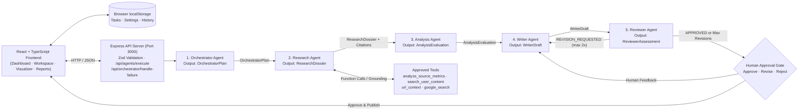

# AgentFlow AI

**A full-stack sequential multi-agent AI orchestration platform powered by React, Node.js/Express, TypeScript, and the Google Gemini API.**

AgentFlow AI coordinates five specialized AI agents (**Orchestrator**, **Research**, **Analysis**, **Writer**, and **Reviewer**) to turn complex user prompts and attached source materials into audited, citation-grounded reports with bounded automated revisions, failure recovery, and a mandatory human-in-the-loop approval gate before publishing.

- **Live Deployment:** [AgentFlow AI Live App](https://ais-pre-nwtgdwcykdwhanltzrb2io-738129012262.asia-southeast1.run.app)

---

## Table of Contents

- [Project Overview](#project-overview)
- [Problem Statement](#problem-statement)
- [Features](#features)
- [Multi-Agent Architecture](#multi-agent-architecture)
- [Workflow Explanation](#workflow-explanation)
- [Technology Stack](#technology-stack)
- [Project Structure](#project-structure)
- [API Endpoints](#api-endpoints)
- [Installation & Setup](#installation--setup)
- [Screenshots](#screenshots)
- [Limitations](#limitations)
- [Future Enhancements](#future-enhancements)

---

## Project Overview

Single-prompt LLM interactions often struggle with multi-step reasoning, source verification, structural consistency, and quality control. **AgentFlow AI** addresses this by decomposing each task across five distinct agent roles that execute sequentially on a Node.js/Express backend using structured JSON schemas (`@google/genai`), passing typed handoff objects from one stage to the next.

A dark-mode SaaS dashboard lets operators configure tasks, upload or paste reference documents, approve specific research tools, monitor live node progress and execution logs, inspect exact per-agent inputs and outputs, export final deliverables in JSON or plain text, and persist workflow runs in browser `localStorage`.

---

## Problem Statement

When teams use generative AI for technical audits, market briefs, or operational action plans, single-shot prompting introduces four recurring challenges:

1. **Lack of Structured Decomposition:** One monolithic prompt mixes planning, fact extraction, critique, and final prose generation, making errors hard to isolate.
2. **Opaque Execution & Weak Handoffs:** Without inspecting intermediate reasoning, operators cannot verify whether downstream conclusions actually trace back to source evidence.
3. **Unchecked Draft Quality:** Outputs are presented without an automated audit pass or bounded revision cycle against the original requirements.
4. **Unsafe Publishing & Exposed Secrets:** Client-side API calls risk exposing credentials, and unreviewed outputs risk publishing unverified claims without human sign-off.

AgentFlow AI solves these issues through server-side Gemini execution, typed agent-to-agent handoffs, a bounded Reviewer-to-Writer revision loop, Orchestrator-managed error recovery, and a human publishing checkpoint.

---

## Features

- **Five Specialized Sequential Agents:**
  - **Orchestrator Agent:** Decomposes the user brief into objectives, research questions, analysis criteria, a report outline, and a reviewer verification checklist (`OrchestratorPlan`).
  - **Research Agent:** Answers Orchestrator research questions using attached user content, reference URLs, and explicitly approved tools (`ResearchDossier`).
  - **Analysis Agent:** Evaluates the `ResearchDossier` against Orchestrator criteria to surface patterns, confidence levels, risks, and evidence gaps (`AnalysisEvaluation`).
  - **Writer Agent:** Synthesizes all upstream structured outputs into a formatted report (`Executive Brief`, `Technical Report`, `Market Analysis`, or `Operational Action Plan`) (`WriterDraft`).
  - **Reviewer Agent:** Audits the draft for completeness, consistency, and factual grounding (`ReviewerAssessment`), and can request up to **2 automatic revisions** from the Writer before escalating to human review.
- **Approved Research Tooling:**
  - `source_metrics` (`analyze_source_metrics`): Extracts word/line counts, numeric figures, URLs, and recurring terms from attached user content.
  - `fact_extractor` (`search_user_content`): Performs keyword-based line and excerpt lookups inside user-supplied text.
  - `url_context`: Reads content from user-supplied `http`/`https` reference URLs.
  - `google_search`: Opt-in live Google Search grounding via Gemini (with automatic graceful fallback to attached user content and local tools if Search Grounding hits a `429` quota limit).
- **Orchestrator Failure Management:** Automatically diagnoses downstream step failures via `POST /api/orchestrator/handle-failure` (`RETRY_WITH_ADJUSTMENT` with a tailored directive, or `PAUSE_FOR_OPERATOR` while preserving upstream outputs for one-click step-level retry).
- **Human-in-the-Loop Approval Gate:** Completed drafts pause in `awaiting_approval` state where an operator can **Approve & Publish**, **Request Targeted Revision** (with custom feedback routed through Writer + Reviewer), or **Reject**.
- **Seven-Page Dark SaaS Interface:**
  - **Dashboard:** Workspace KPIs, active pipeline spotlight, and recent runs table.
  - **New Task:** Prompt editor, starter brief presets, `.txt/.md/.csv/.json/.log` file attachment, URL list builder, tool approvals, model selection, reasoning depth (`LOW`/`MEDIUM`/`HIGH`), and max revision budget (`0`–`2`).
  - **Agent Workspace:** Sequential execution matrix (start time, completion time, duration, status, received inputs, produced outputs), per-agent inspector tabs (`Output`, `Inputs`, `Raw JSON`), retry buttons, and filterable execution logs.
  - **Workflow Visualizer:** Interactive five-node connected pipeline graph (`Pending`, `Running`, `Completed`, `Failed`, `Revision Requested`), animated progress bars, live elapsed timers, individual agent output panels, and a live log stream.
  - **Reports:** Searchable and filterable report library with Markdown preview, reviewer audit trail, grounding citations, clipboard copy, and **Export JSON** / **Export Text** downloads.
  - **Task History:** Persistent browser `localStorage` archive with search, status filters, token/duration totals, and per-task or full-history deletion dialogs.
  - **Settings:** Live backend/API key health verification, workspace/operator labels, default model/depth/tool configuration, and full workspace JSON backup export.
- **Security & Validation:** `GEMINI_API_KEY` stays strictly server-side; all API payloads are validated with `zod`; exponential backoff handles transient upstream retries.

---

## Multi-Agent Architecture



---

## Workflow Explanation

1. **Task Initialization (`New Task`):** The operator supplies a prompt, optional text/file content, optional reference URLs, approved tools, output format, Gemini model (`gemini-4-hydrogen` or `gemini-3.1-flash-lite`), reasoning depth, and maximum automatic revisions (`0`, `1`, or `2`).
2. **Task Decomposition (`Orchestrator`):** Receives the user brief and returns a structured `OrchestratorPlan` containing objectives, specific research questions, analysis criteria, report section outline, and reviewer checks.
3. **Evidence Gathering (`Research`):** Receives the `OrchestratorPlan` plus user content/URLs. Executes approved Gemini tools and local function calls (`analyze_source_metrics`, `search_user_content`), then structures findings into a `ResearchDossier` with confidence tags and verified citations.
4. **Critical Evaluation (`Analysis`):** Receives `OrchestratorPlan` and `ResearchDossier`, evaluating evidence against criteria to produce an `AnalysisEvaluation` (key findings, patterns, severity-ranked risks/mitigations, and data completeness notes).
5. **Report Synthesis (`Writer`):** Receives `OrchestratorPlan`, `ResearchDossier`, and `AnalysisEvaluation` to generate a structured `WriterDraft` and compiled Markdown report.
6. **Automated Audit & Revision Loop (`Reviewer`):** Audits `WriterDraft` against all upstream artifacts (`OrchestratorPlan`, `ResearchDossier`, `AnalysisEvaluation`).
   - If `verdict === "REVISION_REQUESTED"` and `revisionCount < maxRevisions`, the Orchestrator increments the revision counter and routes `ReviewerAssessment` back to the **Writer** for a targeted rewrite, followed by another **Reviewer** check (capped at 2 automatic revisions).
7. **Failure Recovery (`Orchestrator Recovery`):** If any downstream agent fails (e.g., transient `429 RATE_LIMITED` or `UPSTREAM_ERROR`), the client invokes `/api/orchestrator/handle-failure` to decide between one adjusted automatic retry (`RETRY_WITH_ADJUSTMENT`) or pausing safely (`PAUSE_FOR_OPERATOR`) with all completed upstream outputs intact.
8. **Human Approval Gate (`Reports` / `Agent Workspace`):** Once automated review concludes, the task enters `awaiting_approval`. The operator can approve and publish the report, request an additional human-guided revision, or reject it. Published and in-progress reports can be exported as `.json` or `.txt`.

---

## Technology Stack

| Layer | Technologies |
| :--- | :--- |
| **Frontend** | React 19, TypeScript, Vite 8, Tailwind CSS v4 (`@tailwindcss/vite`), Motion (`motion/react`), Lucide Icons |
| **Backend** | Node.js (v22+ native TypeScript support), Express 4, Zod 4, `dotenv`, `tsx` |
| **AI & Grounding** | `@google/genai` SDK (`gemini-4-hydrogen`, `gemini-3.1-flash-lite`), Structured Outputs (`responseSchema`), Function Calling, URL Context, Google Search Grounding |
| **Persistence & Export** | Browser `localStorage` (`agentflow_tasks_v1`, `agentflow_settings_v1`, `agentflow_active_task_v1`), Client-side JSON & plain-text Blob exports |

---

## Project Structure

```text
├── server.ts                        # Express server, Zod validation, API routes & Vite middleware
├── server/
│   └── agents.ts                    # 5-agent Gemini prompts, JSON schemas, tools & failure recovery
├── src/
│   ├── App.tsx                      # Root shell layout & 7-page navigation switcher
│   ├── context/
│   │   └── AgentFlowContext.tsx     # Pipeline runner, revision loop, failure handler & localStorage state
│   ├── types/
│   │   └── agentflow.ts             # Shared TypeScript interfaces for agents, handoffs, tasks & logs
│   ├── utils/
│   │   └── taskHelpers.ts           # Task initialization, progress calculation, presets & JSON/TXT export
│   ├── components/
│   │   ├── ConfirmDialog.tsx        # Accessible confirmation modal for destructive actions
│   │   ├── MarkdownRenderer.tsx     # Safe Markdown renderer for reports and agent outputs
│   │   ├── Sidebar.tsx              # Responsive navigation sidebar
│   │   ├── StatusLabel.tsx          # Semantic task and agent status indicators
│   │   └── TopBar.tsx               # Page title bar, health indicator & quick actions
│   └── pages/
│       ├── DashboardPage.tsx        # KPIs, active workflow summary & recent runs
│       ├── NewTaskPage.tsx          # Task configuration form, presets & file/URL inputs
│       ├── AgentWorkspacePage.tsx   # Execution matrix, step inspector & approval controls
│       ├── WorkflowVisualizerPage.tsx # 5-node connected graph, progress bars & live logs
│       ├── ReportsPage.tsx          # Report library, audit trail & JSON/Text exports
│       ├── TaskHistoryPage.tsx      # Searchable/filterable persistent task archive
│       └── SettingsPage.tsx         # Runtime status check, defaults & JSON workspace backup
├── .env.example                     # Environment variable template
├── package.json                     # Dependencies and run scripts
└── vite.config.ts                   # Vite + React + Tailwind configuration
```

---

## API Endpoints

| Method | Endpoint | Purpose |
| :--- | :--- | :--- |
| `GET` | `/api/health` | Checks backend availability, server-side `GEMINI_API_KEY` configuration, and supported models. |
| `POST` | `/api/agents/execute` | Validates request body via Zod and executes a single sequential agent (`orchestrator`, `research`, `analysis`, `writer`, or `reviewer`) with upstream outputs. |
| `POST` | `/api/orchestrator/handle-failure` | Evaluates a failed agent error and returns `RETRY_WITH_ADJUSTMENT` (with an adjusted directive) or `PAUSE_FOR_OPERATOR`. |

---

## Installation & Setup

### Prerequisites

- **Node.js** `v20+` (`v22+` recommended for `npm start` running `node server.ts`)
- **npm**
- A **Google Gemini API Key** (free tier supported via Google AI Studio)

### Local Development

1. **Clone the repository and install dependencies:**

   ```bash
   git clone <your-repository-url>
   cd agentflow-ai
   npm install
   ```

2. **Configure environment variables:**

   Create a `.env` file based on `.env.example` and add your Gemini API key:

   ```env
   GEMINI_API_KEY="your_actual_gemini_api_key"
   APP_URL="http://localhost:3000"
   ```

   > **Security Note:** Never expose `GEMINI_API_KEY` with a `VITE_` prefix or commit `.env` to version control. The Express server reads it exclusively on the backend.

3. **Start the full-stack development server (port 3000):**

   ```bash
   npm run dev
   ```

   Open `http://localhost:3000` in your browser.

4. **Type-check and build for production:**

   ```bash
   npm run lint
   npm run build
   NODE_ENV=production npm start
   ```

---

## Screenshots

> Add screenshots of your running workspace to `docs/screenshots/` and link them below before publishing your repository.

| View | Description | Suggested File |
| :--- | :--- | :--- |
| **Dashboard** | KPI overview, active 5-agent summary strip, and recent workflow runs | `docs/screenshots/dashboard.png` |
| **Workflow Visualizer** | Five connected agent nodes with live status, animated progress bars, individual output panels, and execution logs | `docs/screenshots/workflow-visualizer.png` |
| **Agent Workspace** | Sequential execution matrix showing start/end times, upstream JSON handoff inputs, and Reviewer revision controls | `docs/screenshots/agent-workspace.png` |
| **Reports & Export** | Final Markdown report viewer, Reviewer audit trail, human approval bar, and JSON/Text export buttons | `docs/screenshots/reports.png` |

---

## Limitations

- **Client-Local Persistence:** Task history, execution logs, and settings are stored in the user's browser `localStorage` rather than a multi-user cloud database; clearing browser storage or switching devices will not carry over past runs (use **Export Workspace JSON** in Settings for backups).
- **Single-Session Execution:** Sequential pipeline coordination runs from the active browser tab via step-by-step HTTP requests; reloading the browser mid-run marks any in-flight step as `INTERRUPTED` so it can be manually retried.
- **API Rate & Grounding Quotas:** Free-tier Gemini API keys may have lower rate limits or restricted **Google Search Grounding** quota (`429 RESOURCE_EXHAUSTED`). When `google_search` hits quota and user-provided content is present, the Research Agent automatically falls back to local content tools.
- **No Real-Time Token Streaming:** Agent responses return cleanly per completed step rather than word-by-word Server-Sent Event (SSE) token streaming.

---

## Future Enhancements

- **Server-Side Persistence & Auth:** Add PostgreSQL / Firestore storage with user authentication so workflows and audit trails sync across devices.
- **SSE / WebSocket Progress Streaming:** Stream intermediate reasoning logs and Research tool invocations in real time during long-running steps.
- **Background Queue Execution:** Decouple multi-agent pipeline execution into server-side job queues so workflows continue safely even if the browser closes.
- **Additional Report Exporters & Diff Views:** Support PDF/Markdown downloads and side-by-side diffs comparing initial drafts against Reviewer-revised drafts.
- **Automated Test Suite:** Add Vitest unit tests for Zod schemas and Playwright end-to-end UI tests.

---

## Deployment

AgentFlow AI is deployed on Google Cloud Run via AI Studio:

- **Live Shared Application:** [https://ais-pre-nwtgdwcykdwhanltzrb2io-738129012262.asia-southeast1.run.app](https://ais-pre-nwtgdwcykdwhanltzrb2io-738129012262.asia-southeast1.run.app)
